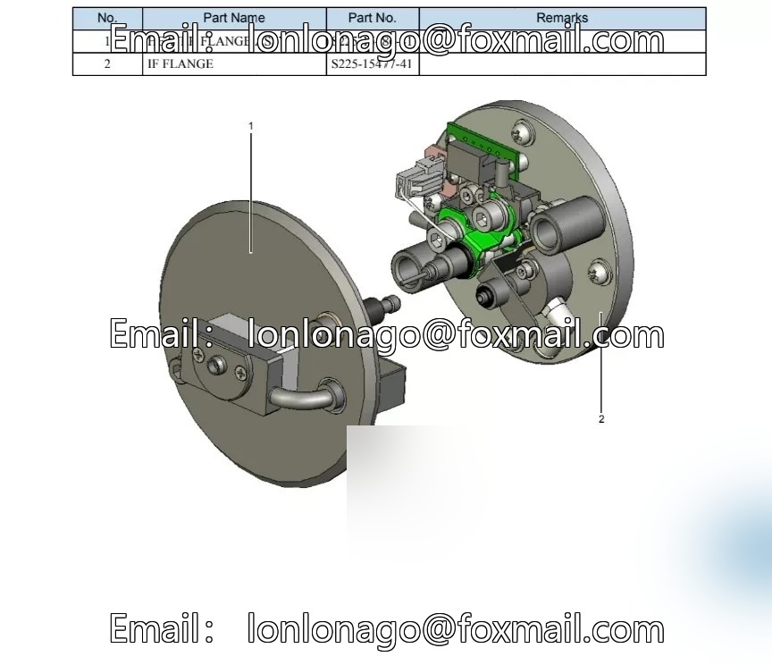
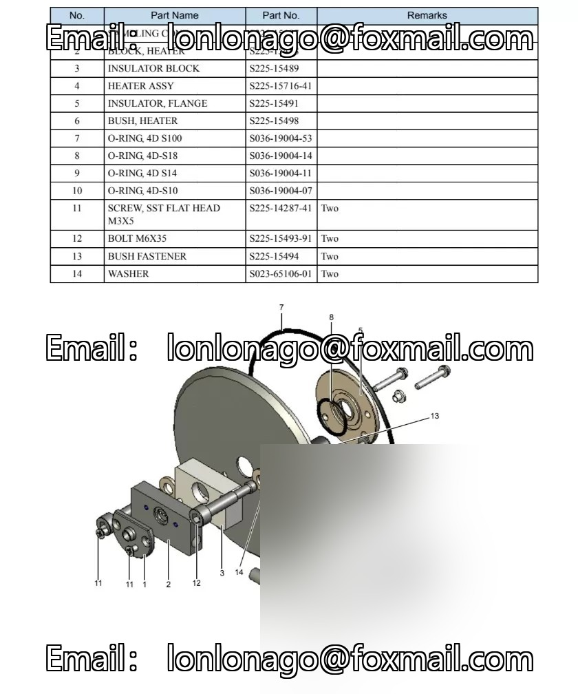
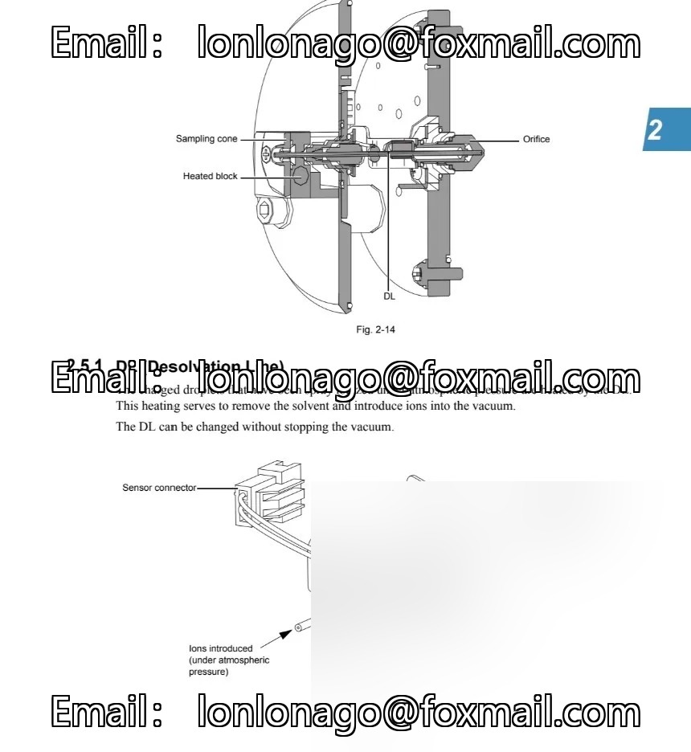
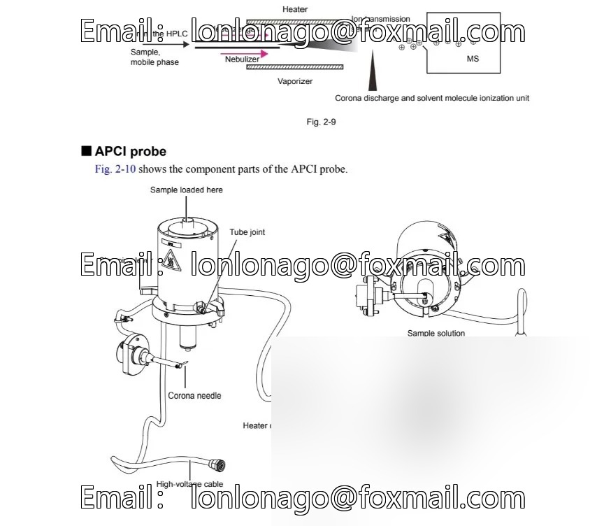
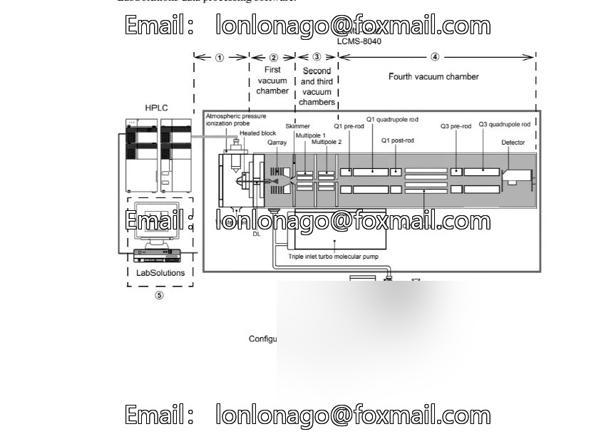

# Shimadzu (SHIMADZU) company HPLC-MS system

## Body

Shimadzu (SHIMADZU) company HPLC-MS/MS operation manual
PDF , 298 pages, content covers models such as LCMS-8030/LCMS-8040, APCI-8030, DUIS-8030, etc., suitable for maintenance, operation, and technical reference.
717689934-Shi.
sold without refund and exchange.

This is the operation manual for a Shimadzu HPLC-MS/MS instrument, provided as a PDF with 298 pages covering models such as LCMS-8030/LCMS-8040, APCI-8030 and DUIS-8030, suitable for maintenance, operation and technical reference, along with item numbers.

<!-- AI_ENRICHED -->

## Images

## Payment

Here is a pay link on Stripe ( https://buy.stripe.com/3cs8yP7sY87d0vu9AB ). Please contact me lonlonago@foxmail.com after funding $89, and I will send you a complete data files , thank you!

